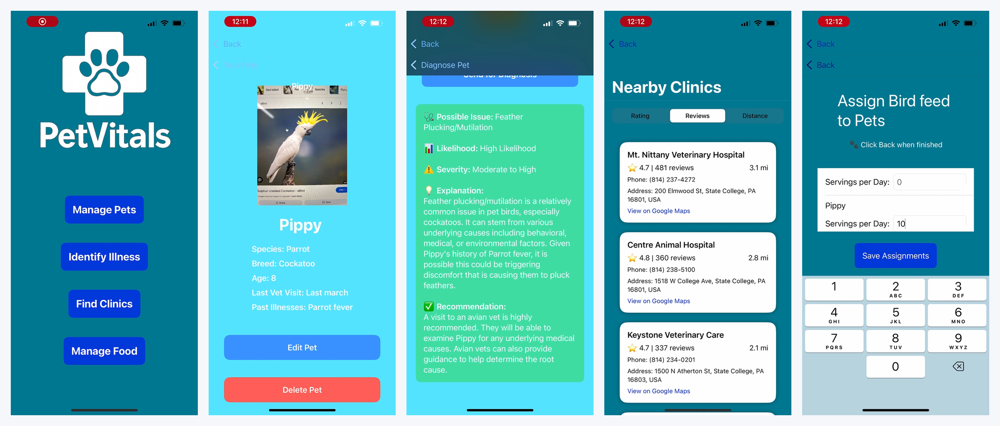

# PetAid (PetVitals)

An iOS app for the daily work of looking after a pet: profiles, an AI symptom checker, nearby vet clinics and a food tracker that tells you before you run out. Built at a hackathon as **PetVitals**; the code and Xcode project use the name PetAid.



## Features

- **Pet profiles.** Add, edit and delete pets (name, age, species, breed, last vet visit, past illnesses) with a photo from the camera or library.
- **AI illness check.** Pick a pet, describe the symptoms and optionally attach a photo. Gemini returns a possible issue, likelihood, severity, an explanation and a recommendation. The prompt tells the model not to give treatment advice, only whether to see a vet.
- **Nearby vet clinics.** Uses your location (5 km radius) and Google Places. Each card shows rating, review count, distance, phone, address and a Google Maps link, and you can sort by rating, reviews or distance.- **Food inventory.** Add foods with total servings, assign servings per day to each pet, and the app counts the stock down daily and sends a local notification at 7, 1 and 0 days left.

## How it fits together

```
SwiftUI app (PetAidApp/)                    Flask backend (main.py)
  Menu → Pets / Illness / Clinics / Food      POST /post-data      → Gemini (gemini-2.0-flash) → parsed JSON
  JSON files in Documents (pets, foods)       POST /googleplaces   → Google Places (nearby + details)
  CoreLocation, local notifications           hosted on Render
```

- **App:** SwiftUI, `Codable` models, `pets.json` / `foods.json` in the app's Documents directory, photos stored as JPEG files. No account.
- **Backend:** Flask. `petAidGemini.py` builds the prompt and calls Gemini, `responseToJSON.py` turns the reply into structured fields, `GooglePlace.py` wraps the `googlemaps` client.
- **Image upload:** photos are resized to 640 px wide, JPEG-compressed and sent base64-encoded with the symptom text.

## Run it

**Backend** (Python 3.10+):

```bash
pip install -r requirements.txt
printf 'GEMINI_API_KEY=your-key\nGOOGLE_API_KEY=your-key\n' > .env
python main.py            # dev server on http://localhost:5000
```

**App:** open `PetAidApp/PetAidApp.xcodeproj` in Xcode and run on an iOS 18.2+ simulator or device. The app currently points at the hosted backend (`https://petaidcloud.onrender.com`); to use your local one, change the two URLs in `ClinicSearch/ClinicView.swift` and `IllnessDiagnosis/IllnessView.swift`. The simulator has no camera, so use the photo library there.

## Known issues

- The `/find-pet-clinics` route is unused and broken; the app uses `/googleplaces`.
- Clinic cards label distance in miles but the backend returns kilometres.
- The food auto-feed marker is kept in memory, so it resets when the app restarts.
- Notification triggers still use short testing delays.

## Built with

Swift, SwiftUI, CoreLocation, Python, Flask, Google Gemini, Google Places API, Render. Built by a four-person hackathon team.
